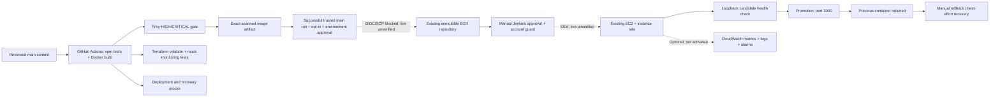

# CloudLaunch — Automated DevOps CI/CD Pipeline

CloudLaunch is a hands-on DevOps project demonstrating a containerized Node.js application, automated CI validation, infrastructure-as-code checks, container security scanning, and controlled deployment and rollback workflows.

## Technology stack

- **Application:** Node.js, Express
- **Containerization:** Docker (multi-stage production build)
- **Continuous integration:** GitHub Actions
- **Continuous delivery:** Jenkins (manually authorized workflows)
- **Infrastructure:** AWS EC2, ECR, Systems Manager (SSM), Terraform
- **Security:** Trivy vulnerability scanning

## CI pipeline

GitHub Actions validates the application, builds a production Docker image, runs Trivy container scanning, validates Terraform infrastructure, and runs deployment safety/recovery tests.

The Trivy security gate is configured to return a failing exit code when the scan detects **HIGH** or **CRITICAL** vulnerabilities.

## 🔐 DevSecOps Security

CloudLaunch integrates automated container vulnerability scanning into its GitHub Actions CI pipeline to help detect security risks before deployment.

### Security controls implemented

- **Multi-stage Docker build:** Installs dependencies in a build stage separately from the production runtime.
- **Reduced attack surface:** Removes unnecessary npm tooling from the production Docker image.
- **Non-root container:** Runs the Node.js application using the `node` user.
- **Automated vulnerability scanning:** Uses Trivy to inspect operating-system packages and Node.js dependencies in the Docker image.
- **Enforced security gate:** The Trivy step returns a failing status for detected HIGH or CRITICAL vulnerabilities.
- **Runtime verification:** The hardened Docker image was successfully launched and checked locally.

### Historical vulnerability remediation results

| Security metric | Before | After |
|---|---:|---:|
| HIGH vulnerability findings | 4 | 0 |
| CRITICAL vulnerability findings | 0 | 0 |
| Production image npm tooling | Included | Removed |
| Trivy CI behavior | Report only | Fails on HIGH/CRITICAL findings |

**Verification:** GitHub Actions CloudLaunch CI Pipeline **#21** passed on commit `5c119a7` with the enforced vulnerability gate enabled.

### Trivy GitHub Actions configuration

```yaml
- name: Scan Docker image with Trivy
  uses: aquasecurity/trivy-action@v0.36.0
  with:
    image-ref: 'cloudlaunch:ci'
    format: 'table'
    severity: 'HIGH,CRITICAL'
    vuln-type: 'os,library'
    exit-code: '1'
```

A passing scan indicates no detected findings at the selected severities at scan time; it does **not** guarantee the absence of all security risks.

**Relevant commits:**
- `4167a61` — Harden Docker runtime with a multi-stage build
- `5c119a7` — Enforce Trivy vulnerability gate in CI

[View GitHub Actions runs](https://github.com/VNavodi/cloudlaunch-devops/actions)

## Deployment and rollback

The repository includes gated Jenkins deployment and rollback workflows, immutable ECR image digest resolution, SSM-driven remote deployment, candidate health checks, and local rollback/recovery tests.

**Production deployment is not automatic.** Jenkins defaults to no deployment, and real deployment or rollback requires explicit authorization. Local rollback scenarios have been tested; live AWS EC2 promotion/rollback remains to be verified.

For prerequisites, operational safety, commands, and test details, read [DEPLOYMENT.md](DEPLOYMENT.md).

## Current limitations

- Jenkins short-lived AWS authentication is not yet provisioned and validated.
- ECR publisher is implemented and default-off; OIDC/SCP approval and live publication are pending.
- Live EC2 promotion and rollback have not been verified end to end.
- Monitoring definitions are implemented and default-off; AWS activation, delivery and notifications are unverified.

The Trivy HIGH/CRITICAL vulnerability gate is implemented; broader security work remains in progress.

## Architecture and implementation status



Account: **636621822646**, Sydney. Existing infrastructure is referenced through Terraform data sources; it has not been imported into Terraform lifecycle management. Monitoring uses opt-in new resource definitions. Main and legacy Terraform roots retain separate lock files.

## Local setup and safe checks

Requires Node.js 24, npm, Bash, util-linux/flock and Terraform (CI pins 1.16.5; mock-provider tests need >=1.7). Docker is needed only for real image tests. From the repository root:

```bash
npm ci --prefix app
npm --prefix app test
bash scripts/validate-local.sh
# Optional Docker check (build first):
docker build -t cloudlaunch:local-audit ./app
bash tests/docker-smoke.sh cloudlaunch:local-audit
terraform -chdir=terraform fmt -check -recursive
terraform -chdir=terraform init -backend=false -input=false -lockfile=readonly
terraform -chdir=terraform validate
terraform -chdir=terraform test
DEPLOY_ENABLED=false bash scripts/deploy.sh sha-example
ROLLBACK_ENABLED=false bash scripts/rollback.sh
npm --prefix app start
```

Local API: GET / and GET /health on port 3000. Server handles SIGTERM/SIGINT gracefully. These local commands do not activate cloud infrastructure. Do not run legacy ECR apply/import or enable monitoring without approval.

## Evidence and operational guides

- [Initial audit and exact gaps](docs/AUDIT.md)
- [Fresh verification, blockers and approval list](docs/VERIFICATION.md)
- [Terraform ownership, import preparation and remote-state design](docs/INFRASTRUCTURE.md)
- [Exact-image publication and OIDC administrator checklist](docs/PUBLISHING.md)
- [CloudWatch design, Sinhala explanation and cost factors](docs/MONITORING.md)
- [Deployment prerequisites and recovery operations](DEPLOYMENT.md)

Historical CI #21 and Docker rollback successes above remain historical achievements. Configuration existence does not verify publishing, live deployment, cloud rollback or monitoring.

## Portfolio / interview

Project objective: demonstrate a reviewable pipeline from application tests and image security checks to manually authorized delivery, with explicit failure recovery and evidence-based infrastructure documentation.

CV bullets supported by implementation and local verification:

- Built a Node.js/Express container pipeline with automated API tests, a non-root multi-stage Docker image and an enforced Trivy HIGH/CRITICAL gate.
- Implemented account-guarded SSM deployment and manual rollback scripts; tested promotion, candidate failure, recovery, signal handling and concurrency using isolated mocks.
- Integrated existing AWS infrastructure through Terraform data sources and prepared opt-in CloudWatch alarms with mock-provider validation.
- Designed a gated OIDC ECR publishing workflow that reuses the exact CI-scanned image; documented organization-policy and live-validation blockers.

Interview explanation: “CloudLaunch එකේ CI tests සහ security scan pass වුණ image එකම publish කරන්න configuration තියෙනවා. Jenkins deployment operator approval එකෙන් පමණයි. Candidate health check fail වුණොත් production වෙනස් කරන්නේ නැහැ. Promotion අතර failure එකකදී previous container restore කරන්න උත්සාහ කරනවා; zero downtime හෝ guaranteed recovery කියලා කියන්නේ නැහැ. AWS live publishing/deployment/monitoring තවම approval සහ verification අවශ්‍යයි.”

Future work: approved OIDC/SCP resolution, short-lived Jenkins identity, real maintenance-window deployment/rollback, monitored health/notification evidence, signed image attestations, approved remote state and hardened Jenkins installer verification. No Kubernetes migration is required.

## Fresh local verification — 2026-11-09

API tests, Docker non-root health/graceful shutdown, deployment/recovery mocks, both Terraform roots, two monitoring mock-provider plans and workflow lint passed. Fresh npm findings were patched; three HIGH OS findings were resolved by refreshing and pinning the official Node base. Final local Trivy result: **0 HIGH / 0 CRITICAL** with exit-code 1 enforced. This does not claim a new hosted CI run, ECR publication or live AWS deployment. See [exact commands and blockers](docs/VERIFICATION.md).
